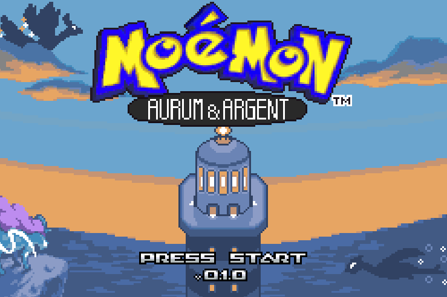
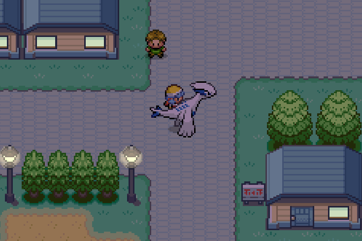

# What is this?

This is a community fork of Pokémon Heart & Soul, with a bunch of minor edits here and there to (hopefully) bring a different experience. This is also a Moémon hack.

# What this is not

This is not Pokémon Heart & Soul. You may find the repository for that game [here](https://github.com/PokemonHnS-Development/pokehns-expansion).

Please do not ask the HnS devs questions related to this specific fork/edit, for they may not be able to help you. For any questions or bug reports, you may contact me on Discord (@chickweedenjoyer).

You may also find the README for Pokémon Heart & Soul [here](README_HNS.md).

# Features

As of version 0.1.0, this fork currently includes the following:

- 99% of mentions of Pokémon are replaced by Moémon (text, graphics, etc.).
- Pokémon battle sprites have been replaced by Moémon sprites (credits below).
- The Alt Shiny palette feature from HnS has been replaced by Alt Shiny sprites, for the following Moémon:
  - Pikachu
  - Onix
  - Slowbro
  - Exeggutor
  - Lapras
  - Sharpedp
  - Camerupt
  - Drapion
- New maps in Johto, both accessible after obtaining the 4th Gym badge, with new encounters and more.
- New encounters available across Johto and other regions.
- A new map in the Ruins of Alph, used to unlock specific regional variants before the post-game.

and much more.

# Credits

Many thanks to :

- The Pokémon Heart & Soul team, for making the base upon which this fork is built.
- The [Moémon Official](https://discord.gg/fHPHSVNaqQ) Discord server, for providing a good chunk of the sprites used here.
  - Specific artist credits can be found [here](MOE_OFF_CREDITS.md).
- BlizzWhite, from the [Moémon Official](https://discord.gg/fHPHSVNaqQ) Discord server, for providing the title screen logo.
- The [Moémon Project](https://discord.gg/p7eUWPamde) Discord server, for providing some of the sprites used here.
- [silversiasma](https://github.com/silversisama), for the Pokémon Ride System (ported from Emerald Rogue) (link [here](https://github.com/silversisama/EE-Ride-System/tree/ride-system)).
- [YuEatMaButt](https://github.com/YuEatMaButt) and [TheKewn01](https://github.com/TheKewn01), for the Overworld Encounter feature (link [here](https://github.com/YuEatMaButt/pokehns-expansion-rice/releases/tag/OWE)).